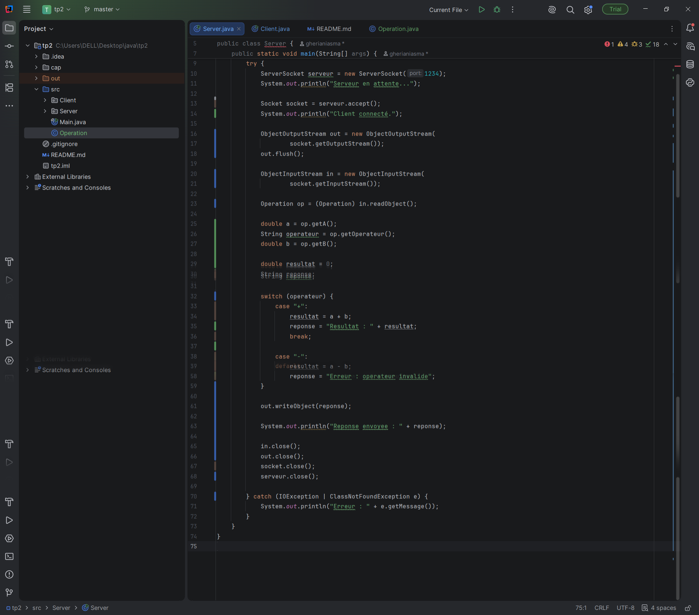

# TP2 — Les sockets en mode connecté TCP
## Activité 2-1 : Échange de chaînes de caractères entre Client/Serveur

### 1. Objectif

L'objectif de ce TP est de réaliser une communication entre un client et un serveur en Java à l'aide des sockets TCP, afin d'échanger des chaînes de caractères complètes.

Le client envoie une opération arithmétique au serveur. Le serveur traite l'opération, effectue le calcul et renvoie le résultat au client.

### 2. Fonctionnement de l'application

**Côté client :**
1. Établir une connexion avec le serveur.
2. Saisir une opération arithmétique.
3. Envoyer l'opération au serveur avec `PrintWriter`.
4. Recevoir et afficher la réponse avec `BufferedReader`.

**Côté serveur :**
1. Attendre la connexion d'un client avec `ServerSocket`.
2. Recevoir l'opération avec `BufferedReader`.
3. Découper la chaîne en trois parties avec `trim()` et `split("\\s+")`.
4. Effectuer le calcul selon l'opérateur.
5. Envoyer le résultat au client avec `PrintWriter`.

### 3. Classes utilisées

| Classe | Rôle |
|---|---|
| `ServerSocket` | Attendre les connexions des clients. |
| `Socket` | Établir la connexion TCP. |
| `InputStream` | Récupérer le flux d'entrée en octets. |
| `OutputStream` | Récupérer le flux de sortie en octets. |
| `InputStreamReader` | Convertir les octets en caractères. |
| `BufferedReader` | Lire les chaînes de caractères avec `readLine()`. |
| `PrintWriter` | Envoyer les chaînes avec `println()`. |

Une vérification est effectuée côté serveur pour détecter les opérations mal formées et éviter la division par zéro.

## Activité 2-2:
1. Objectif

Le but de cette activité est de réaliser une communication entre un client et un serveur en Java avec les sockets TCP, en utilisant l'échange d'objets.

### 2. description

Le projet contient trois classes Java :

Operation.java : représente l'opération mathématique et implémente l'interface Serializable.

Client.java : crée et envoie un objet au serveur, puis reçoit et affiche le résultat.

Server.java : reçoit l'objet, effectue le calcul et renvoie le résultat au client.

### 3. Technologies utilisées

Java

Sockets TCP

Serializable

ObjectInputStream

ObjectOutputStream

IntelliJ IDEA

### 4. Exemple d'exécution
Le client envoie l'opération : 55 * 25

### 5.server:

### 6.client:

